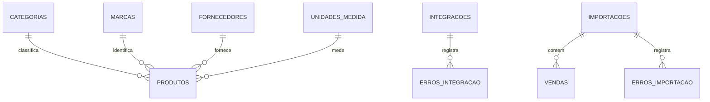

# Modelo e contratos de integração — Grupo 3

## Bancos separados

O Grupo 3 mantém `grupo3_db` em PostgreSQL. O Grupo 1 mantém seu próprio banco de clientes; o Grupo 5 mantém seu próprio banco de pedidos. Não se compartilha uma base única.

As cinco entidades com CRUD de catálogo são `produtos`, `categorias`, `marcas`, `fornecedores` e `unidades_medida`. `clientes_integrados` recebe dados do Grupo 1. As tabelas `integracoes` e `erros_integracao` são histórico de auditoria. `importacoes`, `vendas` e `erros_importacao` preservam o trabalho CSV anterior.

## Contrato enviado pelo Grupo 3 → Grupo 5

**Situação:** implementação alinhada ao contrato enviado pelo Grupo 3; aguardando confirmação conjunta de que esta é a versão a ser usada pelo Grupo 5. **Produtor:** Sistema de Produtos, Grupo 3. **Consumidor:** Sistema de Pedidos, Grupo 5. **Estrutura:** `grupo3_db.public.vw_integracao_produtos`, consultada em modo somente leitura pelo usuário `usuario_integracao_g5`.

| Campo | Tipo PostgreSQL | Obrigatório | Regra |
|---|---|---|---|
| `id_produto` | INTEGER | Sim | Identificador único e permanente |
| `nome` | VARCHAR(120) | Sim | Texto não vazio |
| `descricao` | VARCHAR(500) | Não | Pode ser texto vazio; nosso cadastro grava texto vazio em vez de NULL |
| `categoria` | VARCHAR(100) | Sim | Texto não vazio |
| `preco` | NUMERIC(12,2) | Sim | Maior que zero, em reais |
| `unidade_medida` | VARCHAR(20) | Sim | Unidade de comercialização, por exemplo `UN`, `KG` ou `L` |
| `ativo` | BOOLEAN | Sim | `FALSE` significa produto desativado |
| `atualizado_em` | TIMESTAMPTZ | Sim | Alterado automaticamente ao editar o produto, com fuso horário |

O Grupo 5 identifica produtos por `id_produto`. A chave primária existe na tabela `produtos`; views PostgreSQL não recebem uma restrição `PRIMARY KEY` própria. Produtos desativados continuam na view para que o consumidor receba a alteração. A aplicação não remove produtos fisicamente. O Grupo 5 decide quando consultar e mantém a cópia local no banco próprio. Endereço, porta, senha e acesso de rede precisam ser combinados com o Grupo 5. O usuário criado por `sql/02-grupo5-access.sql` lê apenas a view contratada, sem permissão direta na tabela `produtos`.

O contrato devolvido pelo Grupo 5 propôs outra estrutura, com sete campos e nomes diferentes. A aplicação segue o contrato enviado pelo Grupo 3 até que os grupos concordem formalmente com outra versão.

## Contrato recebido: Grupo 1 → Grupo 3

**Situação:** contrato recebido e conexão real testada em 30/10/2026. **Produtor:** Sistema de Clientes, Grupo 1. **Consumidor:** Sistema de Produtos, Grupo 3. A view contratada é `integracao.vw_integracao_clientes`, acessada com `integ_g3`. O adaptador valida os campos obrigatórios publicados e transforma `codigo_cliente`, `nome_cliente`, `email_cliente`, `cidade`, `ativo` e `data_atualizacao` para o modelo local. CPF e dados financeiros não são persistidos. A finalidade no contrato menciona associação de produtos a clientes, mas o escopo implementado é consultar, validar e armazenar clientes no banco consumidor.

O Grupo 3 guarda `id_cliente_origem` como identificador externo único, valida cada linha, copia os dados válidos para `clientes_integrados` e registra cada execução e seus erros. Uma nova execução atualiza clientes alterados e não duplica os inalterados. Como a view inclui apenas clientes ativos, um snapshot completo sem rejeições desativa os clientes locais ausentes. O acesso foi testado por túnel TCP e depende de o conector do Grupo 1 permanecer disponível.
