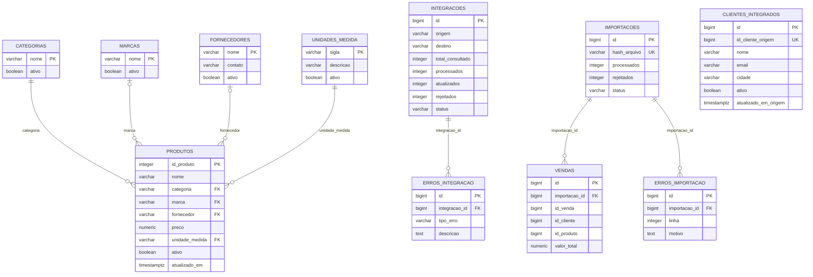

# 4. Modelo lógico do banco `grupo3_db`

Modelo derivado de `02-banco/01-schema.sql`. As setas representam chaves estrangeiras de fato criadas pelo esquema; a view não é uma tabela e aparece em nota ao final.

**Notas:** `clientes_integrados` tem origem externa: `id_cliente_origem` corresponde a `codigo_cliente` no Grupo 1, sem FK entre bancos. `vendas.id_cliente` e `vendas.id_produto` são campos legados da importação CSV; o esquema atual não declara FKs deles para clientes ou produtos. `public.vw_integracao_produtos` projeta oito colunas de `produtos` para o Grupo 5.
